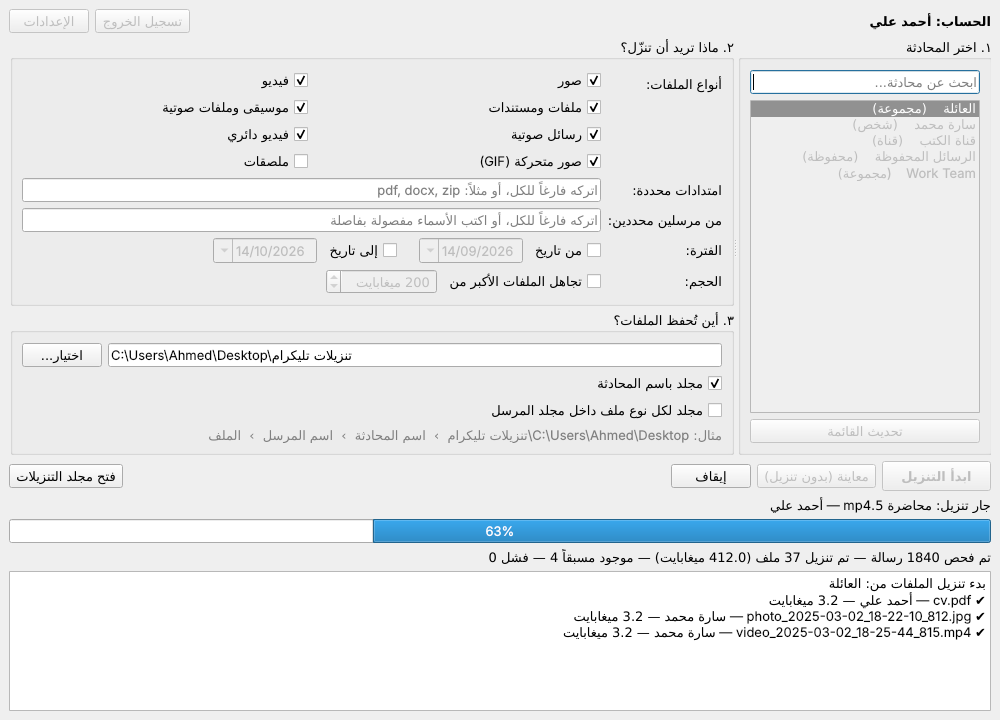

# منزّل ملفات تليكرام

برنامج لويندوز يسجّل الدخول إلى **حسابك الشخصي** في تليكرام، ويمرّ على
محادثة تختارها (خاص، مجموعة، قناة، أو الرسائل المحفوظة)، وينزّل الملفات التي
تحددها، ويضع كل ملف داخل مجلد **باسم الشخص الذي أرسله**.



```
تنزيلات تليكرام/              ← على سطح المكتب (يمكن تغييره)
└── العائلة/                  ← اسم المحادثة
    ├── Ahmed Ali/            ← اسم المرسل
    │   ├── cv.pdf
    │   └── photo_2025-01-02_12-00-00_812.jpg
    └── سارة/
        ├── report.pdf
        └── report (msg 931).pdf   ← ملف آخر بنفس الاسم، لا يُستبدل الأول
```

## البرنامج (ويندوز)

### التشغيل
1. نزّل `TelegramDownloader.exe` وضعه في أي مكان، مثلاً في مجلد على سطح المكتب.
2. اضغط عليه مرتين. لا يحتاج إلى تثبيت ولا إلى Python.
   - البرنامج غير موقّع رقمياً، لذلك قد يظهر تحذير ويندوز «Windows protected your PC».
     اضغط **More info** ثم **Run anyway**.
3. في أول تشغيل يطلب البرنامج **API ID** و **API Hash** (مرة واحدة فقط). الخطوات
   مكتوبة داخل نافذة الإعدادات، وملخّصها في قسم «المتطلبات» أدناه.
4. اختر طريقة الدخول:
   - **رمز QR (موصى به):** افتح تليكرام على هاتفك ← الإعدادات ← الأجهزة ←
     ربط جهاز سطح المكتب، ثم امسح الرمز الظاهر في البرنامج. لا يحتاج إلى كود.
   - **رقم الهاتف:** اكتب الرقم مع رمز الدولة، ثم الكود الذي يرسله تليكرام.
   بعدها يبقى الدخول محفوظاً.
5. اختر المحادثة من القائمة، وحدد أنواع الملفات، ثم اضغط **ابدأ التنزيل**.
   استخدم **معاينة** لترى عدد الملفات وحجمها قبل التنزيل.

**تسمية الملفات بالأرقام:** من قائمة «تسمية الملفات» اختر «أرقام متسلسلة»، فتُسمّى
الملفات 1، 2، 3… بترقيم منفصل لكل نوع داخل مجلد كل مرسل (الصور وحدها، والوورد وحدها،
وPDF وحدها…). يتغير الاسم فقط ولا يُعدَّل محتوى الملف.

يُحفظ الدخول والإعدادات في `%APPDATA%\TelegramDownloader`.

### لا يصلني كود الدخول؟
- الحل الأسهل: استخدم **الدخول برمز QR** بدلاً من رقم الهاتف، فهو لا يحتاج إلى كود.
- نافذة الكود في البرنامج تخبرك **أين أُرسل الكود بالضبط**: داخل تطبيق تليكرام،
  أو برسالة SMS، أو إلى بريدك الإلكتروني.
- إذا قالت «داخل تطبيق تليكرام»: افتح تليكرام على هاتفك وابحث عن محادثة اسمها
  **Telegram** بعلامة زرقاء ✔. الكود لا يأتي برسالة SMS في هذه الحالة.
- إذا كان حسابك مضبوطاً على «بريد الدخول» (Login email) فالكود يذهب إلى البريد،
  وليس إلى تليكرام. افحص صندوق Spam أيضاً.
- إذا لم يصل، اضغط زر **أرسل الكود برسالة SMS / باتصال** في نفس النافذة.
- اكتب الرقم كاملاً مع رمز الدولة ويبدأ بـ `+`.
- كثرة المحاولات تجعل تليكرام يوقف الإرسال مؤقتاً. انتظر بضع ساعات.

### التحديث التلقائي
عند فتح البرنامج يتحقق من وجود إصدار أحدث، ويعرض عليك التحديث. عند الموافقة ينزّل
النسخة الجديدة، ويتأكد من سلامتها، ويستبدل نفسه ويعيد التشغيل. يمكنك أيضاً الضغط على
زر **التحقق من التحديثات**.

يعتمد التحديث على صفحة الإصدارات (Releases) في مستودع GitHub، لذلك **يجب أن يكون
المستودع عاماً (Public)**. كل بناء جديد ينشر إصداراً جديداً تلقائياً، وما يُكتب في
`release-notes.md` يظهر للمستخدم في نافذة التحديث.

### بناء البرنامج
يُبنى `TelegramDownloader.exe` تلقائياً على GitHub Actions مع كل تحديث
(`.github/workflows/build-windows.yml`) ويظهر في صفحة التشغيل تحت **Artifacts**.
للبناء يدوياً على ويندوز:

```bat
pip install -r requirements-gui.txt pyinstaller
pyinstaller --onefile --windowed --name TelegramDownloader --icon assets/icon.ico --add-data "assets/icon.png;assets" TelegramDownloader.py
```

## نسخة سطر الأوامر

نفس المحرك متاح أيضاً كأداة سطر أوامر (`python -m tgdl`)، وهي مفيدة للأتمتة.

### المتطلبات

1. Python 3.9 أو أحدث.
2. **API ID** و **API Hash** خاصّين بك (مجاناً):
   - ادخل إلى <https://my.telegram.org> برقم هاتفك.
   - اختر **API development tools** وأنشئ تطبيقاً (الاسم والوصف أي شيء).
   - انسخ `api_id` و `api_hash`.

### التثبيت

```bash
pip install -r requirements.txt
cp .env.example .env      # ثم افتح .env وضع فيه TG_API_ID و TG_API_HASH
```

(`cryptg` اختيارية لكنها تسرّع التنزيل بشكل ملحوظ.)

### الاستخدام

أول تشغيل يطلب رقم الهاتف ثم الكود الذي يصلك في تليكرام (وكلمة مرور التحقق
بخطوتين إن كانت مفعلة). بعدها يُحفظ الدخول في ملف `tgdl.session` فلا يُطلب مرة أخرى.

```bash
# 1) اعرض محادثاتك مع أرقامها (ID)
python -m tgdl --list-chats

# 2) جرّب أولاً بدون تنزيل لترى ماذا سيُنزَّل وأين
python -m tgdl --chat "Family" --dry-run

# 3) نزّل
python -m tgdl --chat "Family"
```

#### أمثلة على اختيار الملفات

```bash
# الصور والفيديو فقط
python -m tgdl --chat "Family" --types photo,video

# ملفات PDF و Word فقط من قناة، منذ بداية 2025
python -m tgdl --chat @some_channel --ext pdf,docx --since 2025-01-01

# ما أرسله شخصان محددان فقط، بين تاريخين
python -m tgdl --chat -1001234567890 --from "Ahmed Ali" --from @sara_k \
               --since 2025-03-01 --until 2025-03-31

# رسائل محددة بأرقامها (رقم الرسالة يظهر في رابطها: t.me/c/123/456 ← 456)
python -m tgdl --chat "Work" --ids 456,457,470

# الرسائل المحفوظة، مع تقسيم إضافي حسب نوع الملف
python -m tgdl --chat me --folder "{sender}/{type}"

# بدون الفيديوهات الكبيرة
python -m tgdl --chat "Family" --max-size 200MB
```

#### الخيارات

| الخيار | المعنى |
|---|---|
| `--chat` | المحادثة: اسمها كما يظهر عندك، أو `@username`، أو رابط `t.me`، أو رقمها من `--list-chats`، أو `me` للرسائل المحفوظة |
| `--types` | أنواع الملفات: `photo, video, document, audio, voice, video_note, gif, sticker` أو `all` (الافتراضي: الكل عدا الملصقات) |
| `--ext` | امتدادات محددة مثل `pdf,docx,zip` |
| `--from` | مرسِل محدد (الاسم، `@username`، أو الرقم). كرّره لأكثر من شخص |
| `--since` / `--until` | من تاريخ / إلى تاريخ (شامل) بصيغة `YYYY-MM-DD` |
| `--ids` | أرقام رسائل محددة |
| `--min-size` / `--max-size` | حدود الحجم مثل `100K`, `500MB`, `2GB` |
| `--limit` | أقصى عدد ملفات |
| `--out` | مجلد الحفظ (الافتراضي `downloads`) |
| `--folder` | شكل المجلدات (الافتراضي `{chat}/{sender}`). المتاح: `{chat} {chat_id} {sender} {sender_id} {username} {type} {year} {month}` |
| `--names` | تسمية الملفات: `original` (الاسم الأصلي، الافتراضي) أو `numbers` (أرقام 1، 2، 3… بترقيم منفصل للصور والوورد وPDF والفيديو… داخل كل مجلد، حسب تاريخ الإرسال) |
| `--parallel` | عدد الملفات التي تُنزَّل في نفس الوقت (الافتراضي 3) |
| `--dry-run` | عرض ما سيُنزَّل دون تنزيل |
| `--list-chats` | عرض المحادثات وأرقامها |
| `--logout` | تسجيل الخروج وحذف ملف الجلسة |

### كيف تعمل

- **البحث عن المحادثة بالاسم** يتم داخل محادثاتك فقط، فلا يمكن أن تذهب كلمة مثل
  `Family` إلى قناة عامة غريبة بنفس الاسم. إن تطابق أكثر من محادثة تعرض الأداة
  أرقامها لتختار.
- **الاستئناف:** تُسجَّل الملفات المنزّلة في `downloads/.tgdl/<chat id>.tsv`.
  إن توقف التنزيل (انقطاع إنترنت أو Ctrl+C) شغّل نفس الأمر مرة أخرى وسيكمل من حيث
  توقف دون إعادة تنزيل ما اكتمل. الملف يُكتب أولاً باسم `.part` ولا يأخذ اسمه
  النهائي إلا بعد اكتماله.
- **تشابه الأسماء:** ملفان مختلفان بنفس الاسم من نفس الشخص يُحفظان معاً، والثاني
  يأخذ رقم رسالته: `report (msg 931).pdf`.
- **أسماء المجلدات** تُنظَّف من الرموز غير المسموحة في ويندوز/ماك/لينكس، والأسماء
  العربية مدعومة. رسائلك أنت في المحادثات الخاصة تذهب إلى مجلد باسمك.
- **حدود تليكرام:** إذا طلب تليكرام الانتظار (FloodWait) تنتظر الأداة تلقائياً ثم
  تكمل. الملف الذي يفشل لا يوقف البقية، ويُذكر في الملخص النهائي.

## الأمان

- ملف الجلسة (`account.session` للبرنامج، و`tgdl.session` لسطر الأوامر) **يساوي
  حسابك مسجّلاً**: لا ترسله لأحد ولا ترفعه إلى GitHub. كذلك ملف `.env`.
- لإنهاء الجلسة: زر **تسجيل الخروج** في البرنامج، أو `python -m tgdl --logout`،
  أو من تليكرام: الإعدادات ← الأجهزة ← إنهاء الجلسة.
- الأداة تقرأ وتنزّل فقط؛ لا ترسل رسائل ولا تحذف شيئاً.
- تعمل عبر واجهة تليكرام الرسمية (MTProto عن طريق مكتبة Telethon). استخدمها على
  حسابك وعلى محادثات أنت عضو فيها، ولتنزيل ما يحق لك الاحتفاظ به.

## التطوير

```bash
pip install -e ".[gui,test]"
pytest
python -m tgdl.gui.app      # تشغيل البرنامج من الكود
```
